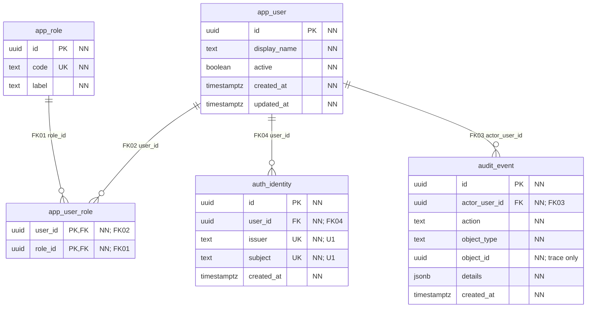
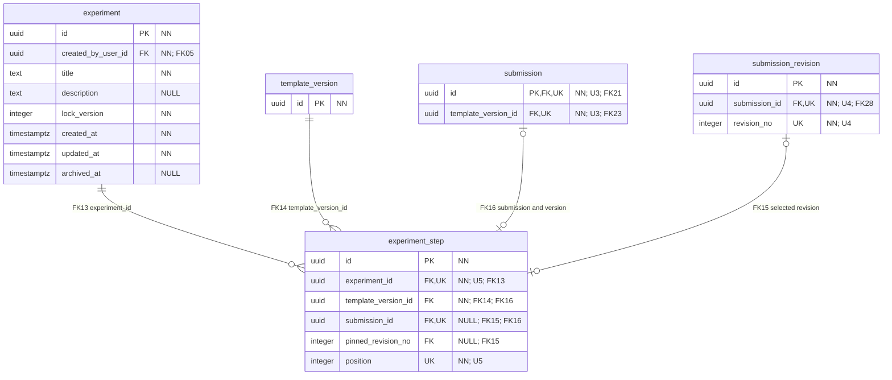
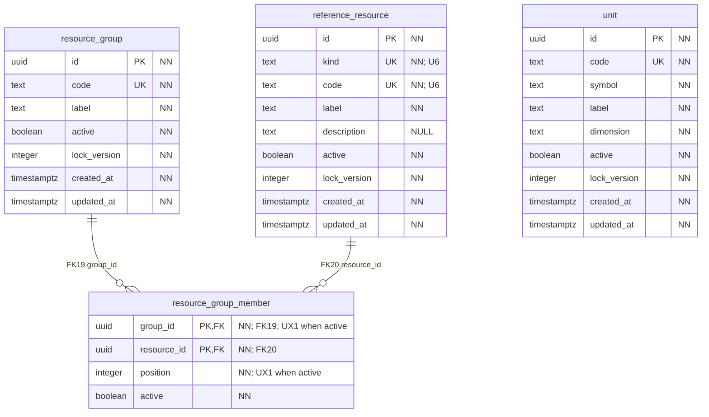
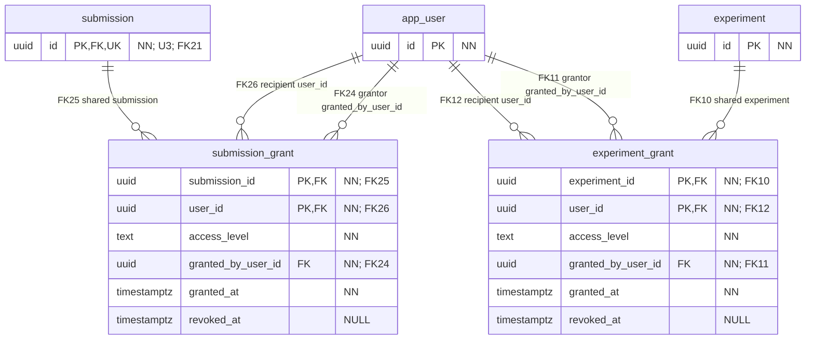
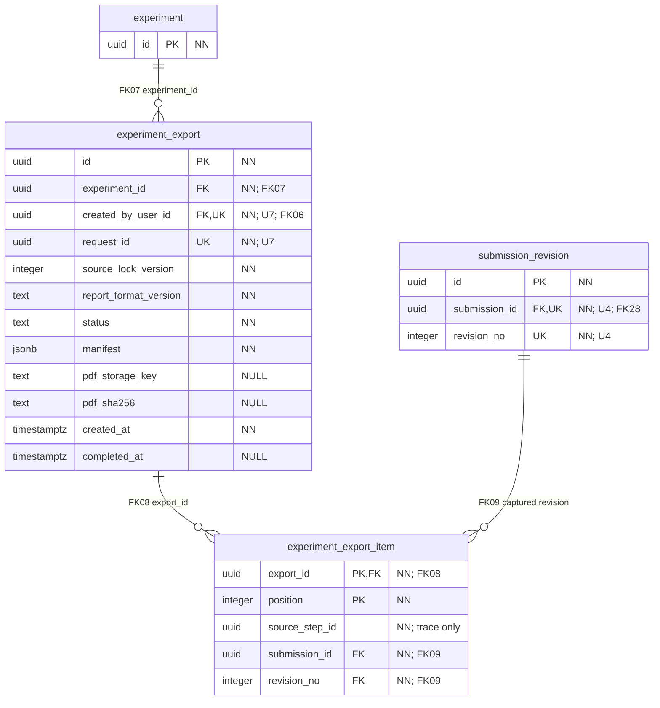
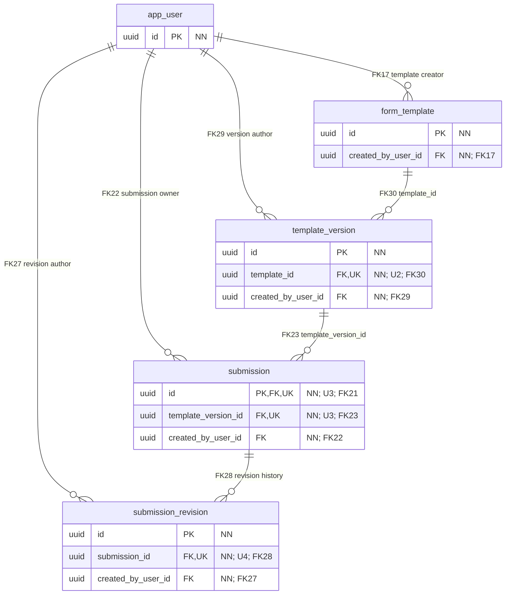
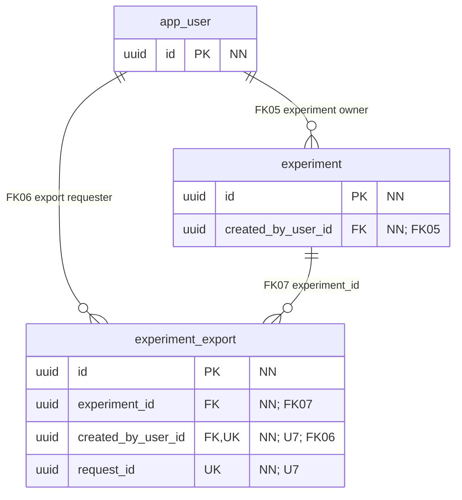

# Complete database ER diagrams — YES 4041

This is the complete physical entity-relationship model for the current database foundation: **20 domain tables, 141 columns, 20 primary keys, 12 unique constraints, one additional partial unique index, and 30 foreign keys**. It matches [migration 0001](../migrations/versions/0001_initial_model.sql) and the checked [schema catalog](schema_catalog.json). Migration bookkeeping tables are outside this domain model.

Use this document to draw the model in Lucidchart. The [data dictionary](DATA_DICTIONARY.md) defines every column, default, validation rule and lifecycle rule. The [relationship register](RELATIONSHIPS.md) provides the exact child and parent column pairs for FK01–FK30. No schema change is proposed by this document.

## Reading the diagrams

- Table and column names are the exact lowercase SQL identifiers in the `public` schema. PostgreSQL types use the migration spellings: `uuid`, `text`, `boolean`, `integer`, `jsonb`, and `timestamptz` (`timestamp with time zone`).
- `PK` marks membership in the table's primary key. Multiple `PK` rows form one composite key; they are not individually unique.
- `FK` marks membership in at least one foreign key. The `FKnn` note identifies its full relationship; both columns of a composite FK carry the same note. A number such as `revision_no` is never a standalone reference target.
- `UK` marks membership in a unique constraint. `U1`–`U7` identify composite unique groups listed below. A column marked `UK` as part of a group is not independently unique. Unlabelled `UK` columns are single-column unique constraints.
- `NN` means `NOT NULL`. `NULL` means the column permits SQL `NULL`; state-dependent checks can still require a value. JSON `null` is different from SQL `NULL`.
- At an endpoint, `||` means exactly one, `o|`/`|o` means zero or one, and `o{`/`}o` means zero or many. The symbol next to a table describes how many rows of that table may be associated with one row at the other end.
- Lines show physical FK relationships. Line style is not used to distinguish identifying relationships. A repeated table is the same table, not a duplicate. Views 1–6 contain every complete table definition; reference-only boxes and views 7–8 show selected columns.

Physical FK cardinality does not require a parent to have children. The diagrams therefore use zero-or-many for version, revision, step and export-item collections. Business transactions impose additional minimums, described after the diagrams.

## Model and diagram index

| View | Full table definitions | Full columns | FK IDs shown |
| --- | --- | ---: | --- |
| 1. Templates and submissions | `equipment`, `form_template`, `template_version`, `submission`, `submission_revision` | 47 | FK18, FK21, FK23, FK28, FK30 |
| 2. Identity, roles and audit | `app_user`, `auth_identity`, `app_role`, `app_user_role`, `audit_event` | 22 | FK01, FK02, FK03, FK04 |
| 3. Experiments and selected revisions | `experiment`, `experiment_step` | 14 | FK13, FK14, FK15, FK16 |
| 4. Reference catalogs | `reference_resource`, `resource_group`, `resource_group_member`, `unit` | 29 | FK19, FK20 |
| 5. Explicit sharing | `submission_grant`, `experiment_grant` | 12 | FK10, FK11, FK12, FK24, FK25, FK26 |
| 6. Retained exports | `experiment_export`, `experiment_export_item` | 17 | FK07, FK08, FK09 |
| 7. Template and submission authors | Reference-only boxes | — | FK17, FK22, FK27, FK29; repeats FK23, FK28, FK30 for context |
| 8. Experiment owners and export authors | Reference-only boxes | — | FK05, FK06; repeats FK07 for context |
| **Total** | **20 complete definitions** | **141** | **All 30 distinct SQL FKs; four deliberate contextual repeats** |

## 1. Templates and submissions

A template belongs to one piece of equipment. Its immutable versions define the form structure, instructions and validation rules. A submission stays pinned to one template version; finalized revisions preserve complete answer and context snapshots.

```mermaid
erDiagram
    direction TB
    equipment ||--o{ form_template : "FK18 equipment_id"
    form_template ||--o{ template_version : "FK30 template_id"
    template_version ||--o{ submission : "FK23 template_version_id"
    submission ||--o{ submission_revision : "FK28 revision history"
    submission_revision |o--o| submission : "FK21 current revision"
    equipment {
        uuid id PK "NN"
        text code UK "NN"
        text name "NN"
        text description "NULL"
        boolean active "NN"
        integer lock_version "NN"
        timestamptz created_at "NN"
        timestamptz updated_at "NN"
    }
    form_template {
        uuid id PK "NN"
        uuid equipment_id FK "NN; FK18"
        uuid created_by_user_id FK "NN; FK17"
        text name "NN"
        integer lock_version "NN"
        timestamptz created_at "NN"
        timestamptz archived_at "NULL"
    }
    template_version {
        uuid id PK "NN"
        uuid template_id FK, UK "NN; U2; FK30"
        integer version_no UK "NN; U2"
        uuid created_by_user_id FK "NN; FK29"
        jsonb definition "NN"
        timestamptz created_at "NN"
    }
    submission {
        uuid id PK, FK, UK "NN; U3; FK21"
        uuid template_version_id FK, UK "NN; U3; FK23"
        uuid created_by_user_id FK "NN; FK22"
        text status "NN"
        integer lock_version "NN"
        integer current_revision_no FK "NULL; FK21"
        text project_reference "NULL"
        text sample_reference "NULL"
        jsonb answers "NN"
        jsonb equipment_snapshot "NULL"
        jsonb reference_snapshot "NULL"
        timestamptz created_at "NN"
        timestamptz updated_at "NN"
        timestamptz submitted_at "NULL"
        timestamptz archived_at "NULL"
    }
    submission_revision {
        uuid id PK "NN"
        uuid submission_id FK, UK "NN; U4; FK28"
        integer revision_no UK "NN; U4"
        uuid created_by_user_id FK "NN; FK27"
        text correction_reason "NULL"
        text project_reference "NN"
        text sample_reference "NN"
        jsonb answers "NN"
        jsonb equipment_snapshot "NN"
        jsonb reference_snapshot "NN"
        timestamptz created_at "NN"
    }
```

**Two different links join submissions and revisions.** FK28 makes every revision belong to one submission. FK21 selects at most one of that same submission's revisions using `(submission.id, submission.current_revision_no)` → `(submission_revision.submission_id, submission_revision.revision_no)`. A revision can be current for at most one submission. The current-revision FK is deferred until transaction commit, allowing finalization to create a revision and update the current copy atomically.

`project_reference` and `sample_reference` are system context fields, outside `answers` and template conditions. They may be absent in a draft, but both are mandatory in a submitted record and every revision. Their values do not create project or sample entities or grant access to matching records.

## 2. Identity, roles and audit

Users can hold both available roles. An external identity maps an issuer/subject pair to one local user. Audit events identify the actor and retain metadata about the affected object.

`app_user_role` resolves the user/role many-to-many relationship. Role codes are `admin` and `researcher`; administrative catalog access does not imply access to another researcher's submissions. Authentication provider configuration and authorization are backend responsibilities, not inferred from an FK.

`audit_event.object_id` is a polymorphic historical trace interpreted with `object_type`; it is deliberately not an FK. Its presence does not prove that a referenced business object exists.

## 3. Experiments and selected revisions

An experiment contains ordered steps. Each step plans a template version and can later attach a compatible submission. A selected revision fixes the historical content used by that step.

| Link or key | Meaning |
| --- | --- |
| FK14: `experiment_step.template_version_id` → `template_version.id` | Every step has a planned version, including before a submission exists. |
| FK16: `(submission_id, template_version_id)` → `submission.(id, template_version_id)` | An attached submission must use the step's planned version. This is one composite FK. |
| FK15: `(submission_id, pinned_revision_no)` → `submission_revision.(submission_id, revision_no)` | A selected revision must belong to the attached submission. This is separate from FK16. |
| Unique `experiment_step.submission_id` | A submission can be attached to at most one current step, so both attachment and revision-selection relationships have a maximum of one step per source. PostgreSQL permits multiple `NULL` values here. |
| U5: unique `(experiment_id, position)` | Step positions are unique within an experiment; the constraint can be deferred during an atomic reorder. |

A planned step has neither an attached submission nor a selected revision. An attached draft has a submission but no selected revision. The SQL check rejects a selected revision without a submission. Corrections create new revisions without automatically changing a step's selection. Selecting a revision is a backend operation with its own permissions.

## 4. Reference catalogs

Resources can appear in multiple selection groups. Units remain a separate catalog used by dynamic form definitions and answers.

The membership PK is `(group_id, resource_id)`. `UX1` is the **partial unique index** on `(group_id, position) WHERE active`: only active memberships compete for a position. Neither `group_id` nor `position` is globally unique, and inactive memberships can retain previously used positions.

There is no physical link from `unit` to another table, or from a resource to a submission column. Resource, group and unit identifiers inside JSONB are logical references validated by the backend. Historical snapshots preserve the labels and units needed to interpret a revision even after catalog changes.

## 5. Explicit sharing

Each grant connects one object to one recipient. The user who issued the grant is separately recorded; these are different FK roles even when both refer to `app_user`.

The composite PKs permit one current grant row per object/recipient pair. `access_level` is `read` or `edit`; `revoked_at IS NULL` means the grant is not revoked. The backend also checks the current account, role and object permissions. A grant is not ownership: ownership remains with the object's original `created_by_user_id`.

Sharing an experiment does not implicitly share its submissions. Grant creation, editing and revocation require authorization; the grantor FK only guarantees an existing user. Historical grant changes are recorded in audit events.

## 6. Retained exports

An export attempt captures an experiment's selected revisions in an immutable manifest and ordered item list. Its eventual PDF is private and identified by a storage key and SHA-256 digest.

FK09 uses both `(submission_id, revision_no)`. One revision may appear in many historical export items. `(export_id, position)` is the item PK. U7 makes `(created_by_user_id, request_id)` unique for export idempotency; the request ID alone is not globally unique.

`source_step_id` is a required trace UUID **without an FK**. Deleting a current step must not invalidate a retained export. The item still has a real FK to the preserved revision. A valid capture creates at least one item in the same transaction, but FK08 alone does not enforce that minimum.

## 7. Template and submission authors

These reference-only boxes complete the creator links omitted from view 1. The user attributed to a template version or revision is the author of that particular immutable record; this need not be the owner who originally created its template or submission. The three history/context links repeat view 1 to make the author roles easier to follow.

All four creator/author fields are `NOT NULL`. Their FKs establish attribution, not authorization. The backend records the authenticated actor and checks whether that actor may create the template/version or submit/correct the form. A submission's owner remains fixed across revisions.

## 8. Experiment owners and export authors

An experiment's owner and the person requesting an export are recorded independently. FK07 repeats view 6 for context.

The export requester can differ from the experiment owner when current permissions permit the operation. Permission checks cover the experiment and every selected source submission, and are repeated for PDF downloads. The owner/requester FKs alone do not implement those checks.

## Composite keys and conditional uniqueness

Use one key or connector per complete tuple in Lucidchart. Do not split a composite constraint into independent keys or arrows.

| Group | Table and complete columns | Database rule |
| --- | --- | --- |
| Composite PK | `app_user_role.(user_id, role_id)` | One membership per user/role pair. |
| Composite PK | `resource_group_member.(group_id, resource_id)` | One membership per group/resource pair, retained after deactivation. |
| Composite PK | `submission_grant.(submission_id, user_id)` | One grant row per submission/recipient pair. |
| Composite PK | `experiment_grant.(experiment_id, user_id)` | One grant row per experiment/recipient pair. |
| Composite PK | `experiment_export_item.(export_id, position)` | One item at each position within an export. |
| U1 | `auth_identity.(issuer, subject)` | One mapping per external identity. |
| U2 | `template_version.(template_id, version_no)` | Version numbers are unique within a template. |
| U3 | `submission.(id, template_version_id)` | Composite FK target for step/version compatibility; `id` is also the PK. |
| U4 | `submission_revision.(submission_id, revision_no)` | Revision numbers are unique within a submission. |
| U5 | `experiment_step.(experiment_id, position)` | Deferrable unique constraint; initially immediate. |
| U6 | `reference_resource.(kind, code)` | Resource codes are unique within a resource kind. |
| U7 | `experiment_export.(created_by_user_id, request_id)` | Unique export request key for each requester. |
| UX1 | `resource_group_member.(group_id, position) WHERE active` | Partial unique index; applies only to active rows. |

The other five unique constraints are single-column: `app_role.code`, `equipment.code`, `resource_group.code`, `unit.code`, and nullable `experiment_step.submission_id`. All 20 tables have one primary key; the other 15 primary keys are single-column UUID `id` keys.

| Composite FK | Child tuple → parent tuple | Nullability and timing |
| --- | --- | --- |
| FK15 | `experiment_step.(submission_id, pinned_revision_no)` → `submission_revision.(submission_id, revision_no)` | Optional selection; a check prevents a non-null revision number without a submission. Immediate. |
| FK16 | `experiment_step.(submission_id, template_version_id)` → `submission.(id, template_version_id)` | Optional attachment; `template_version_id` remains mandatory and is independently checked by FK14. Immediate. |
| FK21 | `submission.(id, current_revision_no)` → `submission_revision.(submission_id, revision_no)` | No selection in draft; required in submitted state. Deferrable, initially deferred. |
| FK09 | `experiment_export_item.(submission_id, revision_no)` → `submission_revision.(submission_id, revision_no)` | Both columns required. Immediate. |

These FKs use PostgreSQL's default `MATCH SIMPLE`: when any referencing column is SQL `NULL`, that composite FK does not require a parent match. The separate checks and mandatory FKs above close the intended state gaps. All 30 foreign keys use `NO ACTION` for update and delete; there are no cascading historical deletes. Preservation triggers additionally reject forbidden row deletion and mutation as detailed in the dictionary.

## Nullable fields and state-dependent requirements

| Nullable columns | Meaning and restrictions |
| --- | --- |
| `equipment.description`, `experiment.description`, `reference_resource.description` | Optional descriptive text. |
| `form_template.archived_at`, `submission.archived_at`, `experiment.archived_at` | `NULL` means not archived. Archival is separate from submission finalization. |
| `submission.current_revision_no`, `submission.submitted_at` | Both absent in draft and both required when submitted. The first finalization timestamp is retained across corrections. |
| `submission.project_reference`, `submission.sample_reference` | Optional in draft; mandatory when submitted. Each present value has 1–200 characters and no leading or trailing whitespace. |
| `submission.equipment_snapshot`, `submission.reference_snapshot` | May be absent in draft; must be JSON objects when present and are required when submitted. |
| `submission_revision.correction_reason` | Optional explanation, at most 1,000 characters. |
| `experiment_step.submission_id`, `experiment_step.pinned_revision_no` | Permit plan-first work and an attached submission without a selected revision. A selected revision requires a submission. |
| `submission_grant.revoked_at`, `experiment_grant.revoked_at` | `NULL` means the grant has not been revoked. |
| `experiment_export.pdf_storage_key`, `experiment_export.pdf_sha256`, `experiment_export.completed_at` | `pending`: all absent; `failed`: completion time present and PDF fields absent; `ready`: all present, with a nonblank storage key and a 64-character lowercase hexadecimal digest. |

All other columns are `NOT NULL`. JSONB columns shown as objects are checked at their outermost JSON type in SQL; field-level schemas, conditional visibility, repeated groups and reference eligibility are validated by the backend.

## Business relationships beyond FK cardinality

| Operation or rule | Required behavior | Enforcement boundary |
| --- | --- | --- |
| Create a template | Create the template and its first immutable version together. | Backend transaction; FK30 permits zero children by itself. |
| Finalize or correct a submission | Validate and capture a complete immutable revision; synchronize the current submission and snapshots with that revision. | SQL checks/FK21 guarantee a valid selected revision for submitted state; backend transaction ensures full copy equality, allowed revision sequence and validated content. |
| Build an experiment | Empty experiments and unattached planned steps are allowed. Preserve ordered positions and compatible template versions. | SQL FKs/unique constraints plus backend ordering and lifecycle checks. |
| Select a newer revision | Change a step only through an authorized operation; later corrections do not silently repin it. | Backend permissions, locking and archive rules. |
| Capture an export | Require a nonempty experiment with every included step pinned to a readable finalized revision; create the manifest and item list together. | Backend transaction; FK08 does not enforce at least one item or manifest/item equality. |
| Preserve history | Retain immutable template versions, submission revisions, export items and audit events; keep completed export attempts fixed. | SQL triggers and restricted runtime privileges, with backend workflows. |
| Grant access | Require current account/role/object authorization; experiment access does not imply submission access. | Backend on every operation, including historical reads and downloads. |
| Update a mutable object | Use the expected `lock_version` and advance it atomically; maintain applicable update timestamps. | Backend transaction; a positive-integer SQL check does not provide optimistic locking by itself. |

The diagram is complete for the current baseline. It does not claim that a database FK implements the backend workflows, authentication, authorization or scientific validation.

## Deliberately absent relationships

- `project_reference` and `sample_reference` are plain text system references, not FKs or uniqueness keys. No separate project/sample catalog was supplied or introduced.
- `experiment_export_item.source_step_id` preserves the originating step UUID without tying historical exports to a removable current step.
- `audit_event.object_id` records a polymorphic object identifier, not a FK to multiple possible tables.
- Template field IDs, repeated-instance IDs and resource/group/unit IDs inside JSONB are validated logical references. Do not draw them as physical SQL FKs or introduce one SQL table per template or dynamic field.
- Equipment context is reached through `submission` → `template_version` → `form_template` → `equipment`; its captured historical display data lives in snapshots. There is no additional `submission.equipment_id` column.
- Export files are stored outside PostgreSQL; `pdf_storage_key` identifies a private object, and `pdf_sha256` records its digest. Neither is a FK to a file table.

## Lucidchart completion checklist

1. Create eight pages or frames in the order above. Use the same exact SQL table names throughout and label reference-only copies as the same underlying table.
2. Draw every full table definition from views 1–6, including type, PK/FK/UK membership and `NN`/`NULL`. Keep composite key groups in table notes so that individual member columns are not mistaken for independent unique keys.
3. Add each FK01–FK30 connector with the exact complete tuple from the relationship register. Keep separate connectors for current revision versus revision history, and for grant recipient versus grantor.
4. Use the physical cardinalities shown here. Add transaction notes for first versions, first finalized revisions and nonempty export captures; do not represent those service requirements as FK guarantees.
5. Mark FK21 as initially deferred, U5 as deferrable/initially immediate, and UX1 as partial uniqueness for active memberships. Do not add physical connectors for trace-only or JSON references.
6. Confirm the final inventory: 20 distinct tables, 141 columns, 20 primary keys, 12 unique constraints, one partial unique index and all 30 distinct FK IDs. The four repeated FK lines in author views are context, not additional constraints.

See [LUCIDCHART_GUIDE.md](LUCIDCHART_GUIDE.md) for the modeling/import workflow and [DATA_DICTIONARY.md](DATA_DICTIONARY.md) for the complete field and constraint reference.
